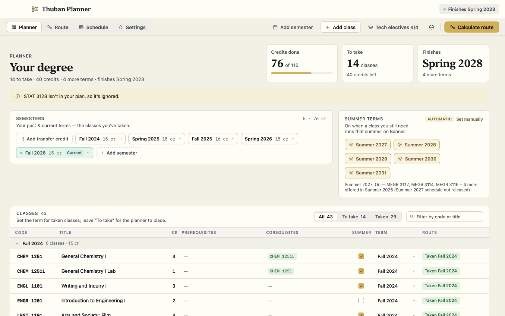
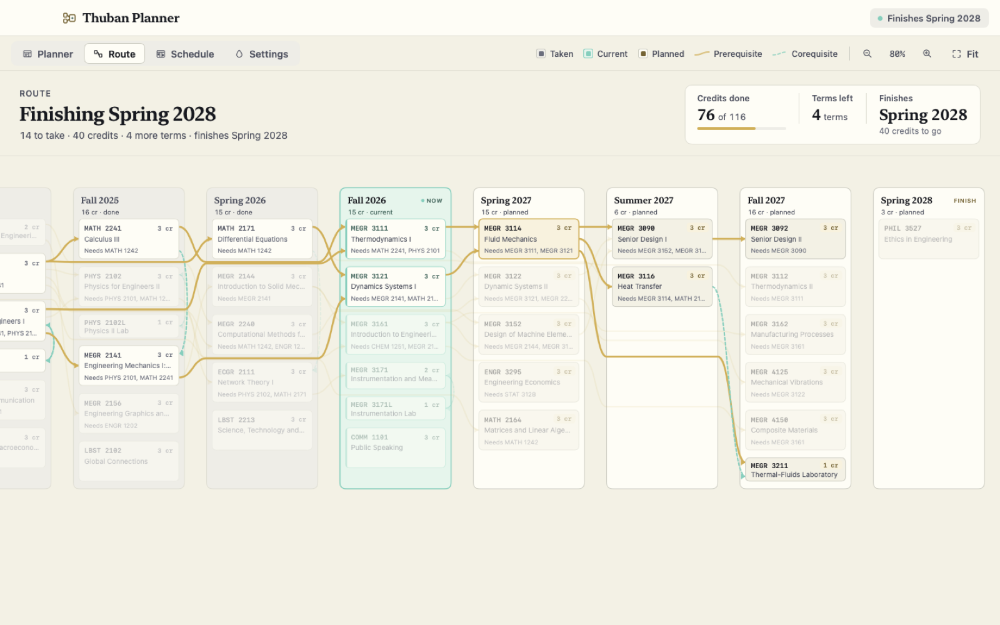
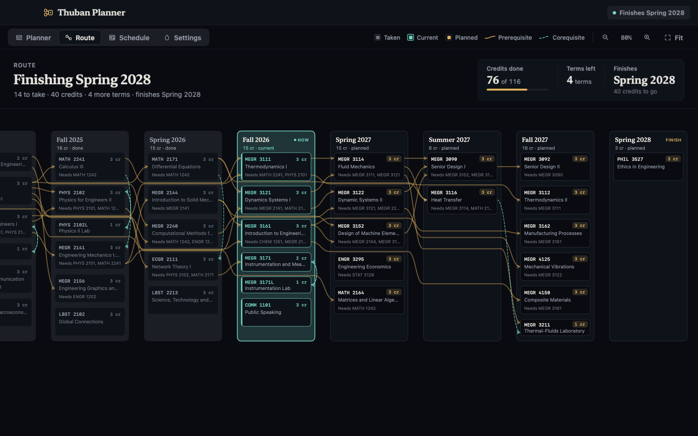
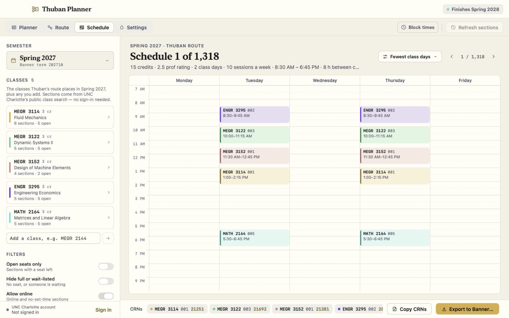
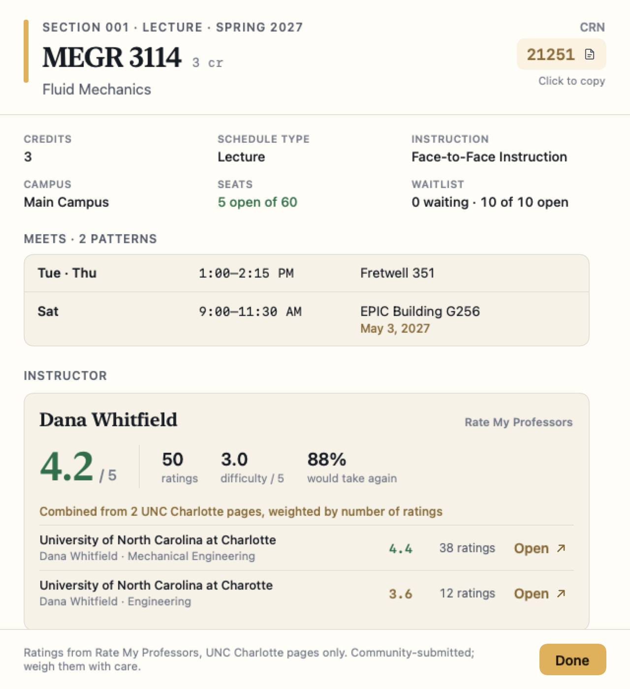
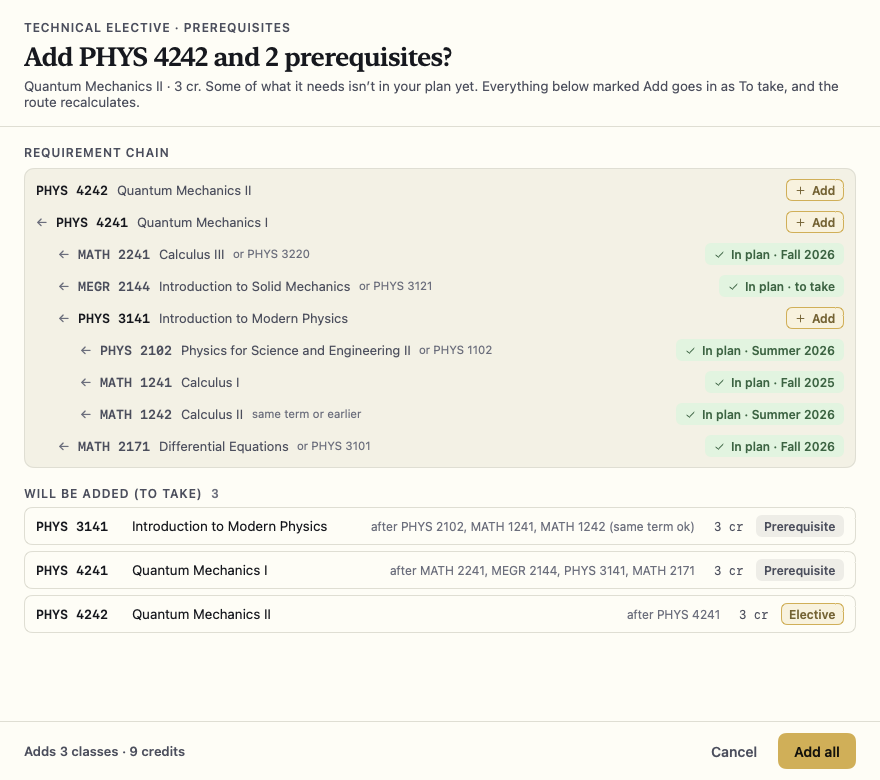
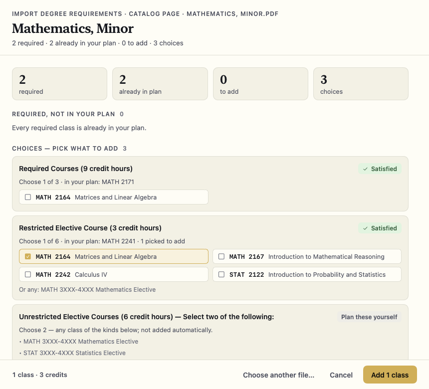

# Thuban Planner

A native macOS degree planner: record what you've taken, and it lays out the fastest route to graduation, then builds your weekly timetable from live section data.



## Why

Planning a four-year engineering degree means juggling prerequisite chains, corequisite pairs, per-term credit caps, summers that may or may not run, and electives with their own hidden prerequisites. Spreadsheets don't know any of those rules. Thuban Planner keeps the degree as one document, schedules the remaining classes term by term, and carries the plan through to an actual registration-week timetable. The bundled catalog data covers UNC Charlotte's B.S. in Mechanical Engineering. The planner and scheduler themselves work for any list of courses.

## Features

### Planning
- **Degree board.** Past and current semesters, transfer credit, and every class with credits, prerequisites (earlier term), corequisites (same term or earlier) and summer availability. Filter by To take / Taken, edit inline, and see credits done, classes left and the projected finish term at a glance.
- **Route scheduler.** Packs remaining classes into future terms under per-term credit caps. Three strategies: graduate soonest using summers, use summers only when they save a term, or a lighter, even load. Optional minimum credits per term.
- **Automatic summer terms.** Each upcoming summer is switched on or off depending on whether a class you still need ran that summer in the university's public class search. Each decision comes with a plain-language reason. Manual toggles are one click away.
- **Warnings.** Classes that can't be placed (missing prerequisites, cycles), terms under your minimum, and references to classes that aren't in your plan.

### Route view
- **Prerequisite map.** A zoomable, Sankey-style board with one column per term and one box per class. Box height scales with credits; solid ribbons mark prerequisites and dashed ribbons mark corequisites. Hover or select a class to highlight its full chain.
- **Class detail.** Prerequisites, corequisites, what each class unlocks ("Required by"), and where it sits on the route.

### Degree requirements
- **Technical electives.** Browse the program's elective list with recent and upcoming offerings, see which ones you're ready for, and add an elective together with any missing prerequisite chain, including OR-choices.
- **Import degree requirements.** Read a catalog page, a degree audit or a checksheet (PDF, HTML, MHTML, DOCX or text), preview what's required, what's already planned and which choices remain, then add only what you pick. The import never removes anything.

### Registration
- **Section data.** Pulls sections for a term from Banner's public class search, so no sign-in is needed. It generates every conflict-free weekly timetable for the classes the route plans that term.
- **Timetable sorting and filters.** Sort by fewest class days, professor rating and other criteria, combined in priority order. Filter for open seats, waitlists and online sections, and block out times you're busy.
- **Professor ratings.** Section detail shows each instructor's RateMyProfessors rating, difficulty and would-take-again share, combined across matching school pages and cached locally.
- **Export to Banner (optional).** After you sign in yourself on the university's own page and confirm, it can create a new Plan Ahead plan from the timetable on screen. It never registers you, and never changes or deletes an existing plan.

### Data and appearance
- **Local-first storage.** The plan is a single JSON document with atomic writes, 14 daily backups and named snapshots you can restore.
- **Legacy import.** A read-only import from a legacy self-hosted Atlas database.
- **Themes.** Light, dark or automatic, eight color schemes and adjustable text size, shared with the rest of the Thuban apps.

## Gallery

<table>
  <tr>
    <td width="50%"><br><sub>Route view, highlighting one class's prerequisite chain</sub></td>
    <td width="50%"><br><sub>The full route in dark mode</sub></td>
  </tr>
  <tr>
    <td width="50%"><br><sub>Weekly timetable generated from public section data</sub></td>
    <td width="50%"><br><sub>Section detail with meetings, seats and instructor rating</sub></td>
  </tr>
  <tr>
    <td width="50%"><br><sub>Adding an elective together with its missing prerequisites</sub></td>
    <td width="50%"><br><sub>Previewing a degree-requirements import</sub></td>
  </tr>
</table>

<sub>Screenshots come from the app's offline smoke run on seeded sample data. The student, instructors and ratings are fictional.</sub>

## Built with

- Swift and SwiftUI on macOS 15+, with the route board drawn natively
- A SwiftPM core library (`ThubanPlannerCore`) holding all the domain logic, with unit tests
- XcodeGen (`project.yml`); the Xcode project is generated, not committed
- JavaScriptCore for the scheduler parity tests, PDFKit for document import, WebKit for the optional Banner sign-in
- Python with headless Chromium to refresh the bundled catalog dataset

## How it was built

Thuban Planner was designed and directed by the owner. The code was written with Claude Code (AI-assisted).

## Architecture

- **Thin app, thick core.** The SwiftUI app (`ThubanPlanner/`) reads and writes through one `AppModel`. Every rule (the model, scheduler, catalog, Banner and RateMyProfessors clients, import and storage) lives in `Packages/ThubanPlannerCore`, a SwiftPM package with its own test suite.
- **A scheduler proven equal to the original.** The scheduler is a line-for-line port of the legacy JavaScript scheduler. Two test suites check that it gives the same output. `GoldenScheduleTests` replays 400 seeded plans whose expected output comes from the original JavaScript, generated by running it under macOS's JavaScriptCore (`scripts/golden.sh`). `DifferentialParityTests` runs that JavaScript in-process on 3,200 seeded documents, both realistic and adversarial, and diffs every output field against the Swift version. The tests copy JavaScript semantics exactly, down to V8's TimSort comparator order (`V8Sort`) and `localeCompare` collation. `scripts/v8check.sh` checks the sort port against a real V8 engine.
- **Additions sit outside the ported scheduler.** Minimum credits, transfer credit and automatic summers are separate steps around the ported scheduler. With them turned off, its output is unchanged.
- **Guarded network access.** Banner traffic goes through a request guard with allow and deny lists. Registration endpoints are always denied, and the only write (Plan Ahead export) requires your sign-in and explicit confirmation. All lookups are public and read-only, paced and cached.
- **Smoke-tested UI.** A smoke harness seeds sample data into a temporary home, walks every screen and registered scene in light and dark mode, and writes screenshots. It runs fully offline.

See [ARCHITECTURE.md](ARCHITECTURE.md) for the full design contract.

## Getting started

**Requirements:** macOS 15 or later, Xcode 26, and [XcodeGen](https://github.com/yonaskolb/XcodeGen).

```sh
brew install xcodegen

scripts/build.sh          # Debug build (regenerates the Xcode project from project.yml)
scripts/test.sh           # core unit tests, incl. the scheduler golden and differential parity suites
scripts/smoke.sh          # offline visual smoke run on sample data; writes PNGs to .build/smoke
scripts/install.sh        # Release build, installed to /Applications/Thuban Planner.app
```

To try the app on sample data without touching your own plan:

```sh
THUBAN_PLANNER_HOME=/tmp/planner-demo THUBAN_PLANNER_SEED=sample \
  ".build/DerivedData/Build/Products/Debug/Thuban Planner.app/Contents/MacOS/Thuban Planner"
```

Maintenance scripts:

- `scripts/golden.sh` regenerates the scheduler golden cases from the original JavaScript, using JavaScriptCore (no Node needed).
- `scripts/v8check.sh` checks the V8 sort port against a real V8 runtime (`node` or `deno`).
- `scripts/refresh_catalog.sh` rebuilds the bundled catalog dataset from the public course catalog. Add `--offerings` to refresh the offerings snapshot.

Your plan is stored in `~/Library/Application Support/Thuban Planner/` (or in `$THUBAN_PLANNER_HOME`).

## Part of the Thuban suite

Native Mac apps that share one theme engine:

- [Thuban Study](https://github.com/ChancellorVerdery/thuban-study)
- [Thuban Graph](https://github.com/ChancellorVerdery/thuban-graph)
- [Thuban Canvas](https://github.com/ChancellorVerdery/thuban-canvas)
- [Thuban Desk](https://github.com/ChancellorVerdery/thuban-desk)
- [Thuban Gym](https://github.com/ChancellorVerdery/thuban-gym)

---

RateMyProfessors and Banner are third-party services and are not affiliated with this project.

All rights reserved.
